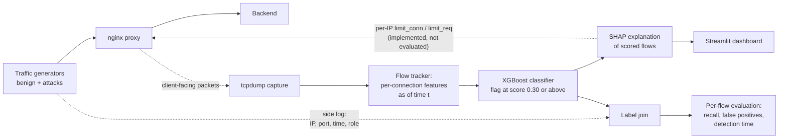

# Sentinel-AI

Detecting slow Layer-7 DoS attacks from per-connection features.

Slowloris and slow POST attacks don't need much traffic. They hold connections open and feed the server a few bytes at a time until it runs out of connection slots. They're also hard to tell apart from a real user on a bad connection, which is why a timeout tight enough to stop them tends to hurt legitimate clients too.

Sentinel-AI takes a different angle. It watches each connection as it happens and scores it from what it has done so far: how long the request has been stalled, how fast it's sending, how long it has gone quiet, and whether the header and body ever finished. In my lab tests that's enough to flag almost every attack within the first second, and the dashboard can show a SHAP explanation for each scored connection.

This repo has everything needed to reproduce that: the Docker test-bed, the feature extractor, the classifier, a replay of the live scoring path, and scripts that evaluate it flow by flow. Everything was measured on lab-generated traffic, and I've tried to be clear about what that does and doesn't prove (see [Scope and known limits](#scope-and-known-limits)).

## What it does well

These are all on held-out lab sessions:

- Holding out one session at a time and pooling the results, 99.2% of attack flows were flagged within 1 s of the connection opening (1,050 of 1,059), with 0.09% of benign flows flagged (2 of 2,154). By 5 s it's 99.7%, with no false positives in 953 benign flows.
- Replaying a recorded capture through the live scoring code, the median attack was flagged 0.7 s after it opened, and 266 of 267 attack flows were caught.
- The result doesn't hinge on byte counts. Dropping the size and volume features still leaves recall at 98.9% at 1 s.
- Every result can be re-run with one command, and the tests check that the offline and live feature code agree.

Just as important to me, the early versions of this evaluation looked too good to be true. The label was leaking through the traffic, among other problems, and I tracked those down and fixed them. That part is written up [below](#problems-i-found-and-fixed-along-the-way).

## Where things stand

| Part | Status |
|---|---|
| Docker lab (traffic generators, nginx proxy, tcpdump, side-log labels) | Built |
| Features computed per connection as of a given time; offline and live code give identical features (tested) | Built |
| XGBoost classifier with per-flow evaluation | Built and verified, see [Results](#results) |
| Replay of the live scoring path (simulated clock) | Built and verified |
| SHAP explanations for scored flows | Built and shown in the dashboard, not evaluated separately |
| Real-time live loop | Not there yet: the Python sensor falls behind under a heavy flood (see [Scope and known limits](#scope-and-known-limits)) |
| nginx mitigation (`limit_conn` / `limit_req`) | Implemented per IP with fixed limits, not evaluated here |
| Per-connection enforcement, shared-IP experiment, tuned-nginx baseline | Planned, see [Roadmap](#roadmap) |

## How it works

Traffic from the generators goes through nginx. tcpdump records the client side, the flow tracker turns each connection into features, and the classifier scores it.



## Data and labels

**The lab.** Generators in `gen/generate.py` send benign and attack traffic through an nginx proxy in Docker, and tcpdump records it. I only analyse the client-facing side (client to proxy, port 80). The proxy's own connections to the backend are left out: they outnumber the client ones by a lot (59,682 against 1,860 in one capture I checked) and say nothing about how a client behaves.

**Labels.** The ground truth never travels in the traffic. (An early version put it in an HTTP header, which leaked it to the model and made the first results look far better than they were. That's gone.) Instead, each generator writes a side log with the source IP and port, start and end time, role and attack type, and flows are joined to it on IP and port within a ±2 s window.

Two labelling setups are used. The offline study (sessions runH to runL) takes the label from the role of the container that generated the traffic, so it's a binary attack-versus-benign study. The replay evaluation uses the side log, which also carries the attack type (slowloris or flood).

**Snapshots.** Each flow is evaluated as of 1, 2, 5, 10 and 20 s after it opened (if it was still open then) and at its final state. Every number below counts one point per unique flow, keyed by session plus flow id.

| Session | Attack flows | Benign flows |
|---|---|---|
| runH | 403 | 445 |
| runI | 202 | 746 |
| runJ | 0 | 554 |
| runK | 403 | 875 |
| runL | 54 | 1,117 |
| **Total** | **1,062** | **3,737** |

The data file is `data/binary_study_client_flows.parquet` (4,799 client flows, 19,058 snapshot rows).

## Method

The classifier sees 13 per-connection features. There's deliberately no IP-level context and no connection age, because age can just echo how long a generator happened to run.

| Feature | Meaning |
|---|---|
| `bytes_in`, `bytes_in_per_s`, `packets_per_s` | volume received so far and its rate over elapsed time |
| `requests_per_s`, `requests_per_conn_so_far` | request rate and count on this connection |
| `interarrival_mean`, `interarrival_std`, `interarrival_max` | gaps between packets so far |
| `stall_time_s` | time the request has been incomplete |
| `header_complete`, `body_frac_sent`, `bytes_declared`, `body_drip_rate_bps` | header/body completeness and body drip rate |

The model is XGBoost (200 trees, depth 4, learning rate 0.1, subsample 0.8, column subsample 0.8, seed 0) with a decision threshold of 0.30. The verified numbers use the raw model scores. The repo has an isotonic calibration helper, but I don't use it for any result below. Intervals are 95% Wilson intervals, and nothing is tuned on the test split.

## Results

### Single split (train runH, test runK + runL, threshold 0.30)

| as_of (s) | attack | benign | TP | FN | FP | TN | recall | FPR | FPR 95% CI |
|---|---|---|---|---|---|---|---|---|---|
| 1 | 455 | 1,376 | 450 | 5 | 7 | 1,369 | 0.989 | 0.0051 | [0.0025, 0.0105] |
| 2 | 455 | 984 | 450 | 5 | 6 | 978 | 0.989 | 0.0061 | [0.0028, 0.0132] |
| 5 | 452 | 621 | 450 | 2 | 3 | 618 | 0.996 | 0.0048 | [0.0016, 0.0141] |
| 10 | 326 | 594 | 324 | 2 | 2 | 592 | 0.994 | 0.0034 | [0.0009, 0.0122] |
| 20 | 152 | 592 | 149 | 3 | 0 | 592 | 0.980 | 0.0000 | [0.0000, 0.0064] |
| final | 457 | 1,992 | 450 | 7 | 17 | 1,975 | 0.985 | 0.0085 | [0.0053, 0.0136] |

Over 5 random seeds, recall at 1 s is 0.989 every time, and the false positives range from 4 to 11 out of 1,376.

### Leave-one-session-out

The stricter check: hold out one session at a time, train on the rest (runJ, which is benign-only, is always in training), and pool the results.

| Time after connect | Attack recall | Benign false positives |
|---|---|---|
| 1 s | 99.2% (1,050/1,059), CI [98.4%, 99.6%] | 0.09% (2/2,154), CI [0.03%, 0.34%] |
| 5 s | 99.7% (1,045/1,048), CI [99.2%, 99.9%] | 0/953 (upper bound 0.40%) |
| final flow | 98.4% (1,045/1,062), CI [97.5%, 99.0%] | 0.13% (4/3,183), CI [0.05%, 0.32%] |

Per held-out session at 1 s: runH 400/402 (0 false positives of 274), runI 200/202 (0 of 504), runK 400/403 (0 of 602), runL 50/52 (2 of 774). runL is the weakest fold; it has only 54 attack flows and a different attacker container.

### Is it just reading byte counts?

I re-ran the single-split experiment without them.

**Without `bytes_in` and `bytes_declared`**

| as_of (s) | attack | benign | TP | FN | FP | TN | recall | FPR | FPR 95% CI |
|---|---|---|---|---|---|---|---|---|---|
| 1 | 455 | 1,376 | 450 | 5 | 0 | 1,376 | 0.989 | 0.0000 | [0.0000, 0.0028] |
| 2 | 455 | 984 | 450 | 5 | 3 | 981 | 0.989 | 0.0030 | [0.0010, 0.0089] |
| 5 | 452 | 621 | 450 | 2 | 2 | 619 | 0.996 | 0.0032 | [0.0009, 0.0117] |
| 10 | 326 | 594 | 324 | 2 | 2 | 592 | 0.994 | 0.0034 | [0.0009, 0.0122] |
| 20 | 152 | 592 | 150 | 2 | 1 | 591 | 0.987 | 0.0017 | [0.0003, 0.0095] |
| final | 457 | 1,992 | 450 | 7 | 10 | 1,982 | 0.985 | 0.0050 | [0.0027, 0.0092] |

**Without any size or volume feature** (`bytes_in`, `bytes_declared`, `packets_per_s`, `bytes_in_per_s`)

| as_of (s) | attack | benign | TP | FN | FP | TN | recall | FPR | FPR 95% CI |
|---|---|---|---|---|---|---|---|---|---|
| 1 | 455 | 1,376 | 450 | 5 | 3 | 1,373 | 0.989 | 0.0022 | [0.0007, 0.0064] |
| 2 | 455 | 984 | 450 | 5 | 4 | 980 | 0.989 | 0.0041 | [0.0016, 0.0104] |
| 5 | 452 | 621 | 450 | 2 | 7 | 614 | 0.996 | 0.0113 | [0.0055, 0.0231] |
| 10 | 326 | 594 | 325 | 1 | 3 | 591 | 0.997 | 0.0051 | [0.0017, 0.0147] |
| 20 | 152 | 592 | 151 | 1 | 1 | 591 | 0.993 | 0.0017 | [0.0003, 0.0095] |
| final | 457 | 1,992 | 450 | 7 | 9 | 1,983 | 0.985 | 0.0045 | [0.0024, 0.0086] |

Recall doesn't move, so the detector isn't simply reading a generator's request size.

### Replay of the live scoring path

To check that the live scoring code behaves like the offline analysis, I replayed a recorded mixed capture through it with a simulated clock (packet timestamps) and one decision per active flow per second. 1,829 of 1,862 flows (98.2%) joined to the side log. The 33 without a side-log row are left out of the metrics (all 33 were flagged). That leaves 267 attack flows (240 slowloris, 27 flood) and 1,562 benign ones.

| Measure | Result |
|---|---|
| Attack flows flagged at least once | 266/267 (99.6%), CI [97.9%, 99.9%] |
| Age at first flag (attacks) | median 0.70 s, p90 1.13 s |
| Benign flows flagged by 1 s | 15/1,562 (0.96%), CI [0.58%, 1.58%] |
| Benign flows flagged at least once over their lifetime | 52/1,562 (3.3%), CI [2.6%, 4.3%] |

One thing worth knowing: false positives pile up with flow age, because every extra decision is another chance to flag. The lifetime figure (3.3%) is the one to think about for a real deployment. The 1 s figures agree with the offline study (0.96% by 1 s in the replay, 0.51% offline, with overlapping intervals).

### Recall by attack behaviour

The groups are a heuristic computed from each flow's final features, not ground truth. Slowloris-like means the header never completes, flood-like means 20 or more requests on the connection or over 50 kB/s, slow-POST-like means a stalled body, and "other" is the rest. Single split, threshold 0.30.

| Group | Flows | Recall at 1 s | Recall at 5 s |
|---|---|---|---|
| flood-like | 150 | 1.000 | 1.000 |
| slowloris-like | 100 | 1.000 | 1.000 |
| slow-POST-like | 159 | 0.987 | 0.987 |
| other | 46 / 43 | 0.935 | 1.000 |

### A deliberately tough test: leave-one-behaviour-out

Train without one attack behaviour, then test on it (single split, threshold 0.30).

| Held-out behaviour | Flows | Recall at 1 s | Recall at 5 s | Recall at final |
|---|---|---|---|---|
| flood-like | 150 | 0.000 | 0.000 | 0.000 |
| slowloris-like | 100 | 0.000 | 0.990 | 0.280 |
| slow-POST-like | 159 | 0.428 | 0.491 | 0.415 |

Recall on the behaviours that were in training stayed between 0.977 and 1.000. So the classifier is good at the attack designs it has seen and doesn't carry over to ones it hasn't. That's a useful thing to know, and it's why the first roadmap item is a hybrid with a simple rate rule for floods.

### Choosing the threshold on validation data

I also tried picking the threshold on validation data for a target false-positive budget. It didn't transfer: a 0.5% budget (threshold 0.1020) gave 1.31% false positives on test at 1 s (18 of 1,376, CI [0.83%, 2.06%]), and a 0.2% budget (threshold 0.1608) gave 0.94% (13 of 1,376). The fixed 0.30 happened to do better, so I'm not claiming a calibrated operating point.

### Why not just use nginx timeouts?

I haven't benchmarked against a tuned nginx yet. As a first look, I built an offline stand-in from per-flow features (an idle-gap timeout of T seconds, with T = 5, 10 or 30, plus a 20 requests/s limit) to see what it would catch:

- It flags only the 150 flood-like flows at 1, 2 and 5 s (33.0%, 33.0% and 33.2% recall) with 0 false positives. At 10 s recall is 35.3% to 38.0%. The model flags 98.9%, 98.9%, 99.6% and 99.4% at the same points.
- Slowloris-like flows have a median largest packet gap of only 3.4 s (slow-POST-like 4.4 s), so a timeout of 5 s or more rarely fires on them.
- The benign data has no legitimate slow header senders, so this understates the false-positive cost of tight timeouts.

It's an approximation, not nginx. I'd treat it as motivation for the approach, not as evidence.

## Scope and known limits

What the lab data can and can't show, and where each limit points next.

- The attack designs repeat in every session, so the results show the detector is stable across sessions. They don't show that it handles new tools or real traffic. Testing new attack tools is on the roadmap.
- The classifier only detects the kinds of attack it was trained on. Held-out flood-like attacks were missed entirely, and held-out slowloris-like attacks were missed at 1 s. That points to a hybrid design: a simple request-rate rule for floods plus the model for the ambiguous slow attacks.
- The hardest benign case isn't in the data yet. Of 442 benign flows with an incomplete header at 1 s (all five sessions), 344 had sent zero bytes. Those are idle connections, not legitimate slow senders, so the false-positive rates don't yet reflect real slow clients. Adding them is the most informative next experiment.
- The offline study labels flows by container role (binary) and the behaviour groups are heuristic. The replay uses per-connection side-log labels.
- Threshold 0.30 is fixed. Thresholds chosen on validation missed their false-positive budgets, and false positives vary by seed (4 to 11 of 1,376) and by session. A more careful calibration protocol is future work.
- Per-snapshot benign counts are in the hundreds to low thousands, so the false-positive intervals are wide. I report them rather than hide them.
- Real-time operation is the main engineering gap. Replaying a capture covering 247 s took 1,441 s, about 5.8 times real time. The capture holds about 7.2 million packets, and 33 connections carried 86% of client-to-proxy packets (4.24 million of 4.95 million), a load the Python sensor couldn't follow in real time. Profiling and batched scoring are next. The replay is the validated path for now.
- Enforcement isn't evaluated. nginx limits are per IP with fixed values, and there's no mitigation result here and no head-to-head against a tuned nginx yet.

## Roadmap

- A hybrid design: a simple request-rate rule for floods plus the model for ambiguous slow attacks.
- Per-connection enforcement, closing only the flagged connection.
- A shared-IP ("cafe") experiment with benign and attack clients behind one address.
- Legitimate slow-header clients in the benign mix.
- A per-tool study with complete side logs, and new attack tools.
- A baseline against a tuned nginx configuration.
- Batched scoring and profiling for real-time operation.
- Dynamic limits derived from benign traffic percentiles.

## Problems I found and fixed along the way

Early versions of this evaluation were too optimistic. Getting to the current numbers meant fixing these:

- The ground-truth label was riding along in the traffic. It now lives in a separate side log.
- Rates are now measured over the time since the connection opened. Before, a connection that sent a burst and then went quiet kept an inflated rate.
- Tests check that offline replay and the live sensor produce identical features.
- The proxy's connections to the backend (about 96% of the "flows" in some captures) were being counted as flows. They're excluded now.
- A generator bug left benign request headers unterminated. Fixed.
- The verification script refuses to run if the same flow appears twice, after duplicate input files doubled every count once.
- The early near-perfect AUC and very low calibration error came from an evaluation with the problems above, so they aren't reported anywhere.

## Reproduce

```bash
python3.12 -m venv .venv && source .venv/bin/activate
pip install -r requirements.txt

# Main offline study (first table above; the 1 s row reads 455 1376 450 5 7 1369)
python scripts/binary_study_verify.py "data/binary_study_client_flows.parquet"

# Leave-one-session-out, leave-one-behaviour-out, seeds, validation threshold, static baseline
python scripts/robustness_tests.py "data/binary_study_client_flows.parquet"

# Replay evaluation from the recorded decisions (reports 1829/1862 = 98.2%)
python scripts/eval_replay.py results/replay_eval/decisions.parquet results/replay_eval/side_log.jsonl
```

Recorded outputs are in `results/binary_study/verified_output.txt`, `results/robustness_output.txt` and `results/replay_eval/verified_output.txt`.

Regenerating the replay decisions needs the original 1.4 GB capture and a trained model, which aren't in the repository. `scripts/check_join_coverage.py` checks a capture against a side log.

## Tests

```bash
pytest tests/test_features.py tests/test_merge.py tests/test_offline_vs_live.py
```

## Dashboard

```bash
streamlit run dashboard/app.py    # http://localhost:8501
```

The dashboard is exploratory. The verified evaluation lives in the scripts and `results/` above.

## Repository layout

```
data/binary_study_client_flows.parquet   client-facing flows, sessions runH-runL
gen/generate.py                          traffic generators and side-log writer
proxy/                                   nginx configuration
m1_capture/                              flow tracking, features, label join
dashboard/                               Streamlit dashboard and live-lab driver
scripts/binary_study_verify.py           main offline evaluation
scripts/robustness_tests.py              robustness suite
scripts/eval_replay.py                   per-flow evaluation of replay decisions
scripts/replay_live.py                   replays a capture through the live scoring code
scripts/check_join_coverage.py           capture-to-side-log join check
results/                                 recorded outputs of the scripts above
tests/                                   unit and integration tests
docs/archive/                            superseded reports, kept for history only
```