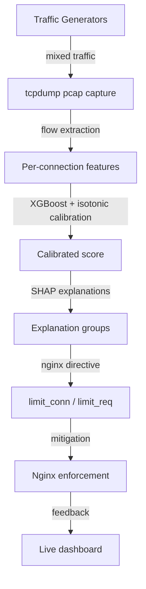

# Sentinel AI — L7 DoS Detection & Mitigation

## Sentinel AI is a lab for detecting slow L7 attacks (Slowloris, slow POST, floods) from per-connection, decision-time features, with a classifier plus SHAP explanations and nginx mitigation.

### Problem
Static nginx timeouts and rate limits force a trade-off (tight limits hurt slow legitimate clients, loose limits let slow attacks through). Sentinel scores each connection from the first seconds of traffic.

### Architecture


### Results
Test = runK+runL, train = runH, per unique flow, threshold 0.30, labels by container IP (binary).

| as_of | attack | benign | TP | FN | FP | TN | recall | FPR | FPR 95% CI |
|------|--------|--------|----|----|----|----|--------|-----|------------|
| 1    | 455    | 1376   | 450 | 5 | 7 | 1369 | 0.989 | 0.0051 | [0.0025, 0.0105] |
| 2    | 455    | 984    | 450 | 5 | 6 | 978  | 0.989 | 0.0061 | [0.0028, 0.0132] |
| 5    | 452    | 621    | 450 | 2 | 3 | 618  | 0.996 | 0.0048 | [0.0016, 0.0141] |
| 10   | 326    | 594    | 324 | 2 | 2 | 592  | 0.994 | 0.0034 | [0.0009, 0.0122] |
| 20   | 152    | 592    | 149 | 3 | 0 | 592  | 0.980 | 0.0000 | [0.0000, 0.0064] |
| final | 457   | 1992   | 450 | 7 | 17 | 1975 | 0.985 | 0.0085 | [0.0053, 0.0136] |

*Default 13 per-connection features, threshold 0.30, per unique flow.*

**Drop bytes_in, bytes_declared**

| as_of | attack | benign | TP | FN | FP | TN | recall | FPR | FPR 95% CI |
|------|--------|--------|----|----|----|----|--------|-----|------------|
| 1    | 455    | 1376   | 450 | 5 | 0 | 1376 | 0.989 | 0.0000 | [0.0000, 0.0028] |
| 2    | 455    | 984    | 450 | 5 | 3 | 981  | 0.989 | 0.0030 | [0.0010, 0.0089] |
| 5    | 452    | 621    | 450 | 2 | 2 | 619  | 0.996 | 0.0032 | [0.0009, 0.0117] |
| 10   | 326    | 594    | 324 | 2 | 2 | 592  | 0.994 | 0.0034 | [0.0009, 0.0122] |
| 20   | 152    | 592    | 150 | 2 | 1 | 591  | 0.987 | 0.0017 | [0.0003, 0.0095] |
| final | 457   | 1992   | 450 | 7 | 10 | 1982 | 0.985 | 0.0050 | [0.0027, 0.0092] |

*Drop bytes_in and bytes_declared, threshold 0.30, per unique flow.*

**Drop all size/volume features**

| as_of | attack | benign | TP | FN | FP | TN | recall | FPR | FPR 95% CI |
|------|--------|--------|----|----|----|----|--------|-----|------------|
| 1    | 455    | 1376   | 450 | 5 | 3 | 1373 | 0.989 | 0.0022 | [0.0007, 0.0064] |
| 2    | 455    | 984    | 450 | 5 | 4 | 980  | 0.989 | 0.0041 | [0.0016, 0.0104] |
| 5    | 452    | 621    | 450 | 2 | 7 | 614  | 0.996 | 0.0113 | [0.0055, 0.0231] |
| 10   | 326    | 594    | 325 | 1 | 3 | 591  | 0.997 | 0.0051 | [0.0017, 0.0147] |
| 20   | 152    | 592    | 151 | 1 | 1 | 591  | 0.993 | 0.0017 | [0.0003, 0.0095] |
| final | 457   | 1992   | 450 | 7 | 9 | 1983 | 0.985 | 0.0045 | [0.0024, 0.0086] |

*Drop concurrent_conns, conns_per_second_opened, stalled_fraction, idle_s, threshold 0.30, per unique flow.*

### Recall by attack behaviour (heuristic grouping of final-flow behaviour)

| as_of | kind | mean | size |
|-------|------|------|------|
| 1 | flood-like | 1.000 | 150 |
| 1 | other | 0.935 | 46 |
| 1 | slow-POST-like | 0.987 | 159 |
| 1 | slowloris-like | 1.000 | 100 |
| 5 | flood-like | 1.000 | 150 |
| 5 | other | 1.000 | 43 |
| 5 | slow-POST-like | 0.987 | 159 |
| 5 | slowloris-like | 1.000 | 100 |

Benign flows with an incomplete header at 1 s: 442; of those, 344 have sent 0 bytes (idle connection, not a slow sender).

### What I fixed along the way (short, factual)
- Ground-truth label moved out of the traffic into a side log
- Features computed as-of time with rate denominators fixed
- Offline replay and live sensor tested to produce identical features
- Removed proxy upstream-leg flows (172.18.0.2)
- Generator header-termination bug fixed
- Duplicate-file guard in the verification script
- "ruddy" → "rudy" typo fix; "Benefit" → "Benign" fix

### Reproduce
```bash
python scripts/binary_study_verify.py "data/binary_study_client_flows.parquet"
```

### Limitations (plain words)
- Lab data; attack designs repeat across sessions, so this shows stability across sessions, not generalization to new tools
- Benign traffic lacks legitimate slow header senders (688 of 884 benign flows with an incomplete header at 1 s sent zero bytes)
- Labels are by container IP so the study is binary
- Threshold 0.30 was not tuned on a validation set
- FPR intervals are wide (few attack flows per as_of)
- Nginx limits are currently per IP, not per connection

### Roadmap
- Per-connection enforcement (close only flagged connections)
- Shared-IP (cafe) experiment
- Per-tool study with proper side logs
- Benign slow-header clients
- Baseline against tuned nginx
- Dynamic limits derived from benign percentiles

### Run
```bash
python3.12 -m venv .venv && source .venv/bin/activate
pip install -r requirements.txt
streamlit run dashboard/app.py
# Open: http://localhost:8501
```